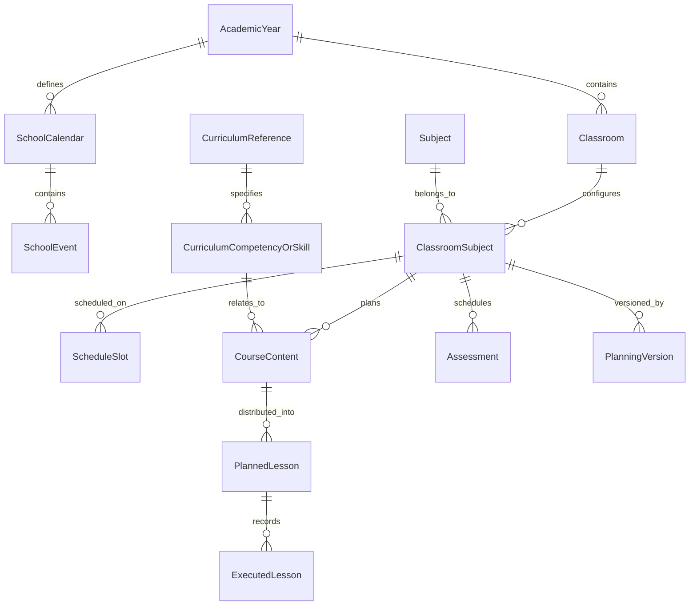

# Modelo de Domínio — Guia de Ensino

Este documento especifica os conceitos, entidades, agregados, objetos de valor e regras de integridade do domínio do **Guia de Ensino**.

---

## 1. Visão Geral dos Conceitos

O domínio pedagógico do Guia de Ensino é centrado na conversão de um currículo escolar em uma trilha temporal de aulas distribuídas deterministamente em um calendário letivo.

---

## 2. Entidades Principais e Atributos

### 2.1 Usuário e Instituição
- **`User`**: Identificador único (`id`), nome, e-mail, preferências de tema e notificação, data de criação e atualização.
- **`School`** (Opcional): Nome da instituição escolar ou rede de ensino, município, estado.

### 2.2 Calendário e Ano Letivo
- **`AcademicYear` (Ano Letivo)**:
  - `id`: UUID.
  - `year`: Ano de referência (ex: `2026`).
  - `title`: Título descritivo (ex: "Ano Letivo 2026").
  - `start_date`: Data de início do período letivo.
  - `end_date`: Data de término do período letivo.
  - `total_mandatory_days`: Meta de dias letivos mínimos (ex: 200 dias segundo a LDB).
- **`SchoolEvent` (Evento / Feriado / Recesso)**:
  - `id`: UUID.
  - `calendar_id`: Vínculo ao calendário.
  - `title`: Nome do evento (ex: "Feriado Nacional - Tiradentes").
  - `start_date`: Data inicial.
  - `end_date`: Data final.
  - `type`: `holiday` (feriado), `recess` (recesso), `pedagogical_meeting` (planejamento sem aula), `administrative_break` (suspensão administrativa).
  - `affects_classes`: Booleano (indica se cancela as aulas regulares).

### 2.3 Turma, Disciplina e Vínculo Pedagógico
- **`Classroom` (Turma)**:
  - `id`: UUID.
  - `academic_year_id`: Vínculo ao ano letivo.
  - `name`: Nome da turma (ex: "6º Ano A", "3º Ano EM B").
  - `grade_level`: Ano/série escolar (ex: Ensino Fundamental 6º ano, EM 1º ano).
  - `shift`: Turno (`morning`, `afternoon`, `evening`, `full_time`).
- **`Subject` (Disciplina)**:
  - `id`: UUID.
  - `name`: Nome da disciplina (ex: "Matemática", "Língua Portuguesa", "História").
  - `color_hex`: Código de cor identificadora para a interface.
- **`ClassroomSubject` (Vínculo Turma-Disciplina)**:
  - **Regra Fundamental**: A configuração de aulas semanais e horários pertence ao vínculo específico entre a turma e a disciplina, e **nunca** à disciplina de forma global. O professor pode ter 4 aulas semanais de Matemática no 9º A e 2 aulas no 9º B.
  - `id`: UUID.
  - `classroom_id`: Identificador da turma.
  - `subject_id`: Identificador da disciplina.
  - `weekly_lessons_count`: Quantidade semanal planejada de aulas.
  - `active`: Booleano indicando vigência.
- **`ScheduleSlot` (Dia e Horário de Aula)**:
  - `id`: UUID.
  - `classroom_subject_id`: Vínculo à disciplina da turma.
  - `weekday`: Dia da semana (1 = Segunda-feira ... 7 = Domingo).
  - `start_time`: Horário de início (ex: `07:30`).
  - `end_time`: Horário de término (ex: `08:20`).
  - `order_index`: Índice da aula no dia (ex: 1ª aula, 2ª aula).

### 2.4 Referência Curricular e Conteúdos
- **`CurriculumReference`**:
  - `id`: UUID.
  - `source_name`: Nome da fonte (ex: "BNCC", "Currículo Paulista", "Proposta Própria").
  - `document_url`: URL oficial ou fonte verificável.
  - `grade_level`: Ano escolar aplicável.
  - `subject_name`: Componente curricular.
- **`CurriculumCompetencyOrSkill` (Habilidade / Código BNCC)**:
  - `id`: UUID.
  - `code`: Código alfanumérico oficial (ex: `EF06MA01`, `EM13MAT101`). Não pode ser inventado.
  - `description`: Texto descritivo oficial da habilidade.
  - `thematic_unit`: Unidade temática.
  - `knowledge_object`: Objeto de conhecimento.
- **`CourseContent` (Conteúdo Programático da Turma)**:
  - `id`: UUID.
  - `classroom_subject_id`: Vínculo à disciplina da turma.
  - `title`: Título do conteúdo (ex: "Operações com Frações e Decimais").
  - `description`: Detalhamento e objetivos pedagógicos.
  - `curriculum_skill_id`: Referência opcional à habilidade da BNCC.
  - `estimated_lessons`: Duração estimada em quantidade de aulas (ex: 4 aulas).
  - `order_index`: Ordem pedagógica sequencial planejada.
  - `is_mandatory`: Booleano (conteúdo obrigatório vs. atividade complementar opcional).
  - `prerequisite_content_ids`: Lista de IDs de conteúdos pré-requisito (dependências).

### 2.5 Aulas Planejadas, Avaliações e Aulas Executadas
- **`PlannedLesson` (Aula Planejada no Calendário)**:
  - `id`: UUID.
  - `classroom_subject_id`: Disciplina e turma.
  - `date`: Data exata da aula calculada pelo motor.
  - `slot_order`: Qual aula do dia (ex: 1ª aula da manhã).
  - `content_ids`: Conteúdo(s) alocado(s) nesta aula.
  - `is_locked`: Booleano (aula com horário/data protegida manualmente pelo professor).
- **`Assessment` (Avaliação)**:
  - `id`: UUID.
  - `classroom_subject_id`: Disciplina e turma.
  - `title`: Título (ex: "Avaliação Bimestral 1").
  - `date`: Data fixada.
  - `lessons_count`: Quantas aulas consome no dia.
  - `is_locked`: Verdadeiro por padrão para datas de prova.
- **`LessonExecutionRecord` (Registro de Execução Fática / Diário de Aula - Etapa 6.1)**:
  - `id`: UUID único e estável.
  - `planned_lesson_id`: Vínculo obrigatório com a aula planejada correspondente.
  - `classroom_subject_id`: Vínculo direto com a disciplina e turma.
  - `execution_date`: Data da realização da aula (normalizada em UTC, sem componente de horário).
  - `status`: Fato consumado (`completed`, `partiallyCompleted`, `notHeld`). O status `planned` é proibido nesta entidade, pois a ausência de registro já expressa estado planejado.
  - `actual_content_ids`: Lista de conteúdos programáticos efetivamente ministrados (sem duplicatas).
  - `cancellation_reason`: Categoria padronizada obrigatória para aulas não realizadas (`LessonCancellationReason`).
  - `cancellation_details`: Detalhes textuais adicionais do cancelamento.
  - `pedagogical_notes`: Anotações reflexivas e observações pedagógicas do docente.
  - `needs_follow_up`: Booleano sinalizando necessidade de continuidade pedagógica.
  - `follow_up_notes`: Detalhamento das pendências a retomar.
  - `recorded_at`: Data e hora de criação do registro original.
  - `updated_at`: Data e hora da última retificação (`isRectified => updated_at != null`).
- **`LessonCancellationReason` (Categorias Padronizadas de Não Realização)**:
  - `schoolEvent`: Evento no calendário escolar, conselho ou reunião pedagógica.
  - `teacherAbsence`: Ausência justificada ou licença do docente.
  - `studentAbsenceOrSuspension`: Ausência de alunos, paralisação ou suspensão de aulas.
  - `infrastructureIssue`: Falta de água/luz, obras ou evento climático adverso.
  - `pedagogicalAdjustment`: Remanejamento de horário ou ajuste pedagógico da escola.
  - `other`: Outro motivo justificado pelo docente.
- **`ClassroomSubjectProgress` (Value Object de Métricas de Execução - Etapa 6.1)**:
  - `classroom_subject_id`: Identificador da disciplina na turma.
  - `total_lessons_planned`: Aulas totais no calendário letivo.
  - `completed_lessons_count`: Aulas concluídas integralmente.
  - `partially_completed_lessons_count`: Aulas com realização parcial.
  - `not_held_lessons_count`: Aulas não realizadas justificadas.
  - `pending_record_lessons_count`: Aulas passadas sem preenchimento de diário.
  - `future_lessons_count`: Aulas futuras aguardando ocorrência.
  - Invariante determinística: `completed + partiallyCompleted + notHeld + pendingRecord + future == totalLessonsPlanned`.
  - Propriedades calculadas: `totalLessonsRecorded`, `totalLessonsEffective`, `completionRate`, `recordingRate`, `hasPendingPastLessons`.
- **`ClassroomSubjectDetailedProgress` (Indicadores Detalhados de Execução e Conteúdo - Etapa 6.3)**:
  - Classificação mutuamente exclusiva e exaustiva:
    - `completedLessonsCount`: Aulas realizadas integralmente (`completed`).
    - `partiallyCompletedLessonsCount`: Aulas realizadas parcialmente (`partiallyCompleted`).
    - `notHeldLessonsCount`: Aulas canceladas/não realizadas com justificativa (`notHeld`).
    - `pendingPastLessonsCount`: Aulas de datas passadas sem apontamento.
    - `pendingTodayLessonsCount`: Aulas programadas para a data de hoje sem apontamento.
    - `futureLessonsCount`: Aulas programadas para datas futuras.
    - **Invariante de Soma**: $\text{completed} + \text{partiallyCompleted} + \text{notHeld} + \text{pendingPast} + \text{pendingToday} + \text{future} = \text{totalLessonsPlanned}$.
  - Taxas e Fórmulas Determinísticas (com numerador e denominador explícitos):
    - `effectiveCompletionRate`: $\frac{\text{completed} + \text{partiallyCompleted}}{\text{totalLessonsPlanned}}$
    - `strictCompletionRate`: $\frac{\text{completed}}{\text{totalLessonsPlanned}}$
    - `recordingRate`: $\frac{\text{totalLessonsRecorded}}{\text{totalLessonsPlanned}}$
    - `cancellationRate`: $\frac{\text{notHeld}}{\text{totalLessonsRecorded}}$ (quando $\text{totalLessonsRecorded} > 0$, senão 0.0)
  - Regra de Conclusão Pedagógica de Conteúdos (Refinamento Conservador da Etapa 6.3):
    - A conclusão de um conteúdo não é inferida por mero registro de presença. Cada conteúdo possui `estimatedLessons` (duração estimada em aulas).
    - Para evitar que um conteúdo com `estimatedLessons = 1` seja prematuramente considerado concluído após uma única aula parcial, adota-se a regra conservadora: **somente aulas com status `completed` acumulam carga horária para a meta de conclusão (`estimatedLessons`)**.
    - Aulas com status `partiallyCompleted` marcam o conteúdo como abordado e mantêm-no no estado **em andamento** (`inProgress`), não comprovando por si sós a conclusão integral.
    - O conteúdo é considerado **concluído** (`completed`) se e somente se $\text{completedLessons} \ge \text{estimatedLessons}$ (com $\text{estimatedLessons} > 0$).
    - Conteúdo **em andamento** (`inProgress`): abordado em ao menos uma aula (`completed` ou `partiallyCompleted`), porém ainda sem atingir a meta integral de aulas concluídas.
    - Conteúdo **não iniciado** (`notStarted`): nunca abordado em aulas com aproveitamento pedagógico (aulas `notHeld` não computam conteúdos).
    - Invariante estrita: $\text{completedContentsCount} + \text{inProgressContentsCount} + \text{notStartedContentsCount} = \text{totalContentsPlannedCount}$.
    - `contentCompletionRate`: $\frac{\text{completedContentsCount}}{\text{totalContentsPlannedCount}}$
  - Continuidade Pedagógica:
    - `pendingFollowUpsCount`: contagem de registros com `needsFollowUp == true`.
    - `followUpRecords`: coleção de registros com pendências a retomar.

### 2.6 Versões e Histórico de Replanejamento
- **`PlanningVersion`**:
  - `id`: UUID.
  - `classroom_subject_id`: Disciplina e turma.
  - `version_number`: Número sequencial (1, 2, 3...).
  - `created_at`: Data e hora da criação da versão.
  - `trigger_reason`: Motivo da versão (ex: "Planejamento inicial", "Replanejamento por aula não realizada em 15/04").
  - `snapshot_data`: Representação estruturada (JSON) da grade alocada naquele momento.
  - `is_active`: Indica a versão vigente no momento.

### 2.7 Contratos do Motor Determinístico de Planejamento (Etapa 5)
- **`PlanningStrategy`**:
  - `pedagogicalSequence`: Ordenação por pré-requisitos pedagógicos e `orderIndex`.
  - `mandatoryFirst`: Priorização de conteúdos obrigatórios antes dos opcionais.
- **`PlanningEngineRequest`**: Parâmetros de entrada contendo datas letivas efetivas, slots de horário da turma, conteúdos a alocar, registros históricos/travas e estratégia.
- **`PlannedLessonAllocation`**: Aula planejada individual acompanhada de seus `contentIds`, flag `isPreservedFromHistory` e explicação textual.
- **`ContentAllocationStatus`**: Estado de alocação de cada conteúdo (aulas necessárias vs alocadas, datas alocadas e motivo de déficit caso incompleto).
- **`PlanningConflict`**: Representação tipada de impedimentos (`invalidConfiguration`, `scheduleMismatch`, `circularPrerequisite`, `insufficientCapacity`, `historicalLessonConflict`).
- **`PlanningEngineResult`**: Resultado estruturado, imutável e 100% determinístico com cálculo exato de capacidade, déficit e explicações pedagógicas.

---

## 3. Regras Invioláveis de Domínio

1. **Imutabilidade Histórica**: A tabela/entidade `ExecutedLesson` / `PlannedLesson` com histórico de execução nunca tem seus registros excluídos durante um planejamento ou replanejamento.
2. **Cálculo Real vs. Multiplicação Teórica**: A quantidade de aulas de um período letivo é contada iterando pelos dias da semana válidos entre `start_date` e `end_date`, subtraindo feriados e eventos que afetam as aulas. Não é permitido aproximar multiplicando semanas por carga horária.
3. **Não-Descarte Silencioso**: Quando o total de aulas necessárias para os conteúdos ultrapassa a capacidade letiva disponível, o sistema não pode apagar conteúdos para "fazer caber". O motor emite o conflito explícito de `insufficientCapacity` com a contagem do déficit em `lessonDeficit`.
4. **Respeito a Compromissos Bloqueados**: Aulas ou avaliações marcadas com `is_locked = true` não são movidas automaticamente pelo algoritmo sem confirmação explícita do professor.
5. **Determinismo Estrito**: O motor em Dart puro gera rigorosamente a mesma saída para o mesmo conjunto de entradas, com IDs estáveis e ordenação topológica à prova de ambiguidades.
