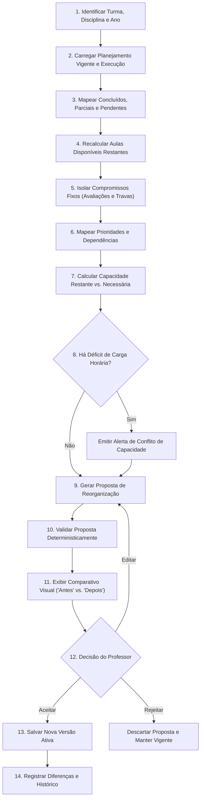

# Motor de Replanejamento Automático — Guia de Ensino

O replanejamento automático é o coração do **Guia de Ensino**. Ele garante que o planejamento pedagógico permaneça vivo e útil frente aos imprevistos da rotina escolar, mantendo total transparência, controle do professor e integridade histórica.

---

## 1. Princípios do Replanejamento

1. **Reversível e Auditável**: Toda proposta de reorganização gera uma nova versão comparável com a anterior.
2. **Determinístico**: O cálculo de realocação temporal segue regras matemáticas precisas em Dart puro, independente de rede ou IA.
3. **Preservação Sagrada do Histórico**: Aulas já realizadas permanecem inalteradas.
4. **Sem Perda Silenciosa de Conteúdo**: Falta de tempo resulta em alerta explícito de déficit, nunca em eliminação arbitrária de habilidades curriculares.
5. **Decisão do Professor**: A IA ou o algoritmo propõem; o professor revisa, altera se desejar e homologa.

---

## 2. Gatilhos de Replanejamento

O replanejamento é acionado quando:
- Uma aula é registrada como `not_held` (não realizada).
- Uma aula é registrada como `partially_completed` (conteúdo ficou incompleto).
- Um conteúdo exigiu mais aulas do que as estimadas originalmente.
- Um feriado, dia sem aula ou evento escolar imprevisto é adicionado ao calendário.
- Ocorre alteração na quantidade de aulas semanais ou nos horários da disciplina.
- Novos conteúdos são adicionados ou excluídos da grade.
- A data de uma avaliação ou evento fixo é remarcada.
- O professor aciona voluntariamente o botão "Replanejar Trilha".

---

## 3. O Fluxo de 14 Etapas Obrigatório

Quando disparado, o motor executa estritamente o seguinte fluxo:

### Detalhes das Etapas:
1. **Identificação do Escopo**: Localiza `classroom_id`, `subject_id` e o intervalo letivo afetado.
2. **Carregamento de Estado**: Busca a versão ativa do planejamento e todos os `ExecutedLesson` registrados.
3. **Classificação de Conteúdos**:
   - *Concluídos*: Conteúdos vinculados a aulas executadas com 100% de progresso (imutáveis).
   - *Parciais*: Conteúdos em andamento que demandam aulas adicionais para finalização.
   - *Pendentes*: Conteúdos futuros ainda não iniciados.
4. **Recálculo de Disponibilidade**: Enumera as datas futuras com horários válidos até o término do ano letivo, desconsiderando feriados e dias sem aula.
5. **Proteção de Bloqueios**: Reserva as datas de avaliações fixadas e aulas explicitamente travadas pelo professor (`is_locked = true`).
6. **Grafo Pedagógico**: Monta a ordenação topológica respeitando as dependências entre conteúdos (`prerequisite_content_ids`).
7. **Cálculo de Capacidade**: Compara o total de aulas restantes com a soma das durações estimadas dos conteúdos pendentes.
8. **Análise de Déficit**: Se a capacidade for menor que a demanda, o sistema lista exatamente quais conteúdos correm risco e apresenta alternativas ao professor (ex: diminuir aulas de revisão, aumentar carga horária, reordenar).
9. **Geração da Proposta**: Aloca os conteúdos pendentes nas próximas aulas disponíveis livres, mantendo a sequência pedagógica.
10. **Validação Determinística**: Testa as regras rígidas: nenhuma aula histórica foi tocada? Nenhuma avaliação fixa foi movida? Pré-requisitos foram respeitados?
11. **Apresentação Didática**: Apresenta ao professor:
    - O que mudou e por quê (ex: "Aula de 18/04 empurrou 'Frações' para 22/04").
    - Lista de datas modificadas em destaque visual.
12. **Interação com o Usuário**: O professor pode aceitar integralmente, editar pontualmente arrastando aulas, ou rejeitar.
13. **Persistência de Versão**: Grava uma nova linha em `PlanningVersion`, tornando-a a versão ativa.
14. **Audit Log**: Armazena o registro descritivo das diferenças entre a versão antiga e a nova.

---

## 4. Política de Priorização em Caso de Déficit

Se a capacidade letiva for insuficiente, a ordenação de prioridade padrão segue a seguinte ordem configurável:
1. **Restrições Legais e Calendáricas**: Feriados e datas de término de período letivo.
2. **Compromissos Fixos e Restrições Explícitas**: Avaliações e dias travados pelo professor.
3. **Conteúdos e Habilidades Obrigatórios**: Objetos de conhecimento essenciais da BNCC/currículo.
4. **Dependências Pedagógicas Fundamentais**: Conteúdos que são base para compreensão de outros.
5. **Prioridades Customizadas**: Critérios prioritários definidos pelo professor.
6. **Revisões, Atividades Complementares e Opcionais**.

> **Aviso Importante**: O sistema nunca cancela unilateralmente itens dos grupos 3 e 4. A responsabilidade de cortar ou condensar conteúdos é estritamente do professor responsável.

---

## 5. Interface com a Inteligência Artificial

Quando habilitada, a IA pode propor sugestões de enriquecimento para a etapa 9:
- Sugerir como condensar dois tópicos correlatos sem perda pedagógica.
- Gerar justificativas didáticas legíveis para o relatório da etapa 11.
- Sugerir estratégias de recuperação para aulas perdidas.

A IA responde sempre em formato JSON estrito, que é imediatamente auditado pela validação determinística da etapa 10.
